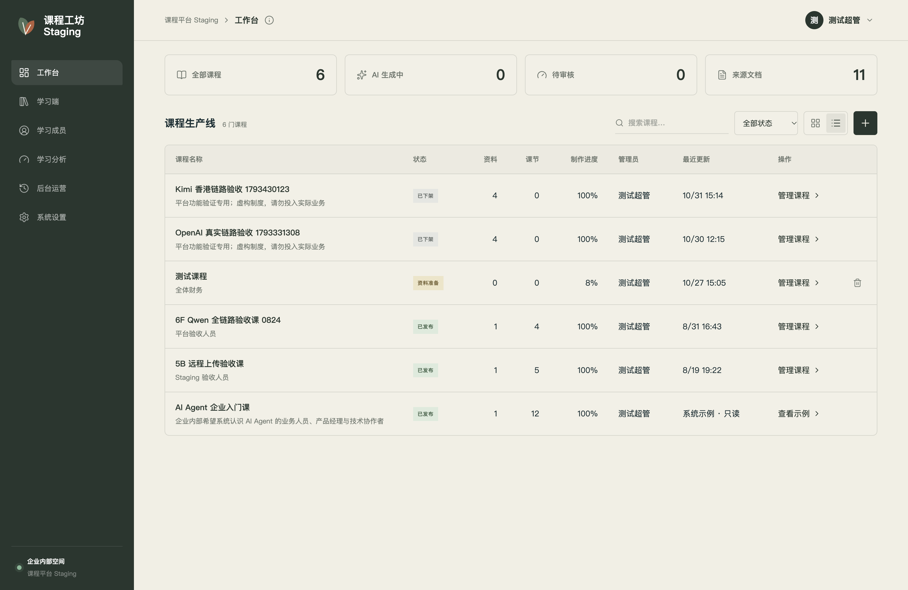
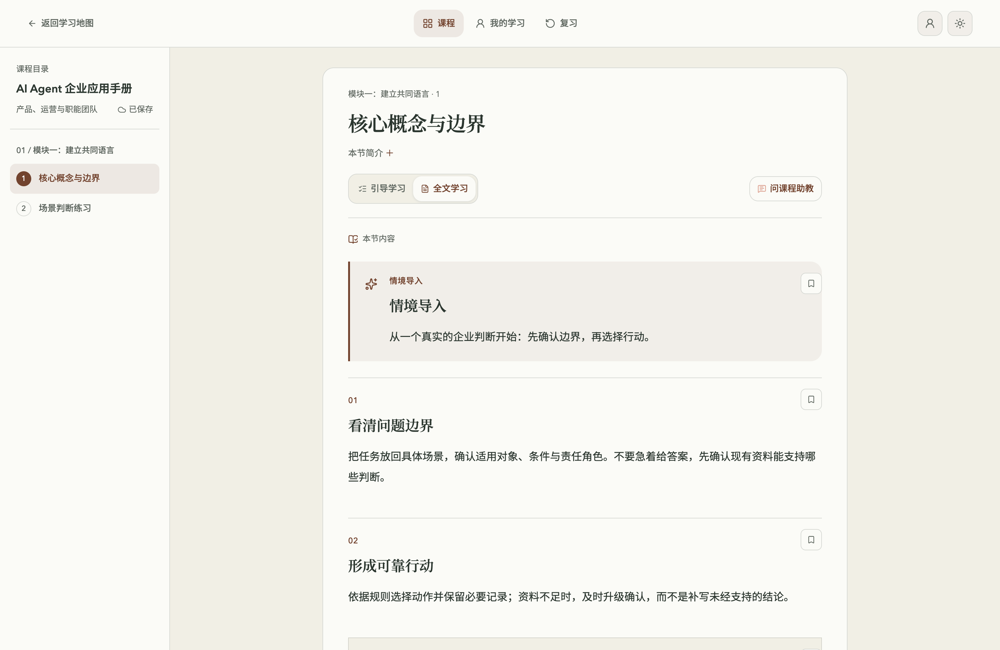
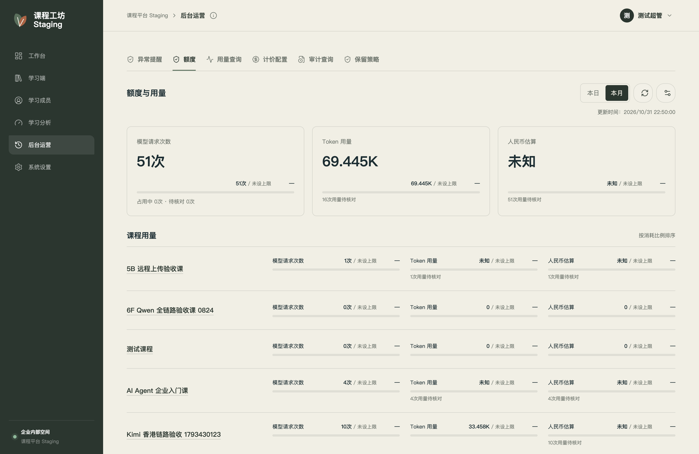
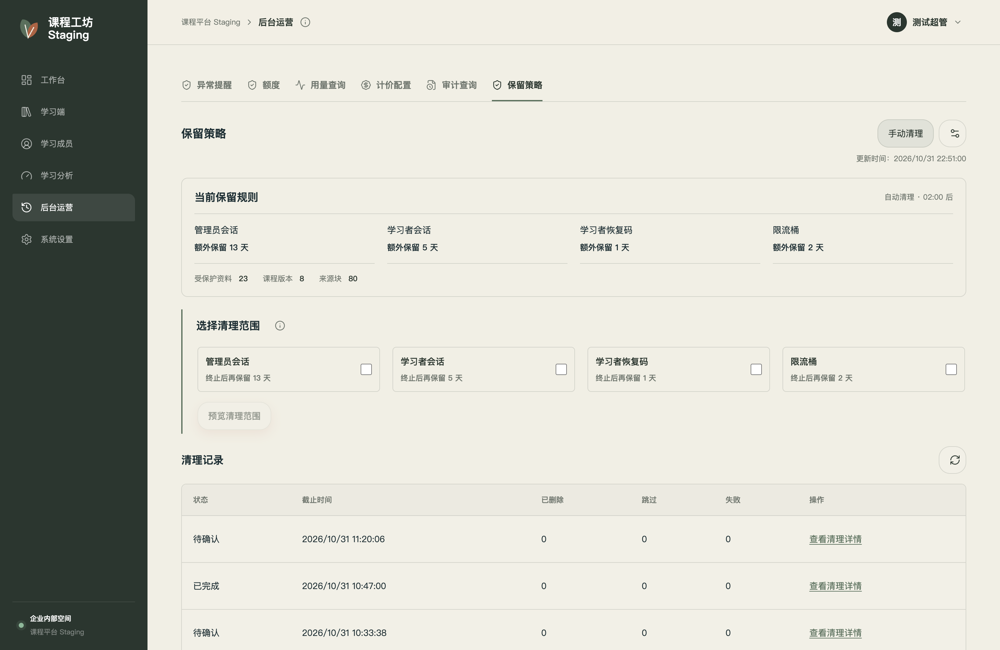

# 课坊 · AI 企业课程与学习平台

**课坊（custom-course-platform）**是一套 AI 企业课程与学习平台，支持将企业制度、业务文档和案例转化为课程，连接内容制作、人工审核、员工学习与日常运营。

[产品介绍](https://songhonglei.github.io/ai-agent-learning/coursePlatform/) · [体验公开课程](https://my-agent-learning.vercel.app/) · [邮件联系：281568337@qq.com](mailto:281568337@qq.com)

> **课坊平台尚未开源。** 本目录只公开产品介绍与界面截图，不包含平台源码、部署配置或企业原始资料。企业和团队如需使用或定制，请邮件联系作者 Evan Song 获取授权。本仓库课程代码的 MIT License 不适用于课坊平台。

## 核心功能

- **AI 辅助制课**：支持 PDF、扫描件、Word 和 Markdown，生成学习目标、大纲与课节内容，保留来源信息，方便核对；中断后可继续生成。
- **内容审核与发布**：支持大纲编辑、内容质检、人工校样和内容重写；审核后发布，保留修改记录。
- **在线学习与练习**：通过课程目录或邀请码学习，完成互动练习与测验，保存学习进度、收藏和错题。
- **课程 AI 助教**：基于有权访问的已发布课程资料答疑，提供引用依据；资料不足时明确说明。
- **平台运营管理**：集中查看异常提醒、操作审计、配额、用量与保留策略；请求次数可设置硬上限，Token 和费用用于提醒。

## 企业定制

| 方向 | 可配置或定制的内容 |
| --- | --- |
| 品牌与界面 | 平台名称、Logo、配色、主题和助教形象 |
| 课程内容 | 按岗位、学习目标和企业资料组织课程、练习与测验 |
| 登录与访问 | 标准 OIDC 企业登录、邮箱准入、课程邀请码与成员管理 |
| AI 模型与识别 | 支持协议内的主模型、备用模型与 OCR 文档识别模型 |
| 运营与用量 | 企业／课程额度、预算提醒、操作记录与保留规则 |
| 部署与系统对接 | 按需求评估部署方案、内部系统对接与新增业务流程 |

现有配置能力与进一步开发的范围会在沟通中明确，不将待评估方案表述为已经交付的功能。

 

页面按屏幕宽度加载无损 WebP，点击可查看高清原图。

## 多主题学习空间

提供东方书卷、工业网格、自然生长、星夜观测、几何乐园、数据终端、典雅学院、靛蓝轻盈、青绿极简九种主题，可按企业品牌配置学习首页。

[查看九宫格主题展示](https://songhonglei.github.io/ai-agent-learning/coursePlatform/#themes)

## 企业使用与授权

课坊平台与开源课程站独立维护，平台本身未开源。

请发送邮件至 **[281568337@qq.com](mailto:281568337@qq.com)**，说明培训场景、使用规模与定制需求。作者 Evan Song 会与你沟通授权方式与实施方案。
