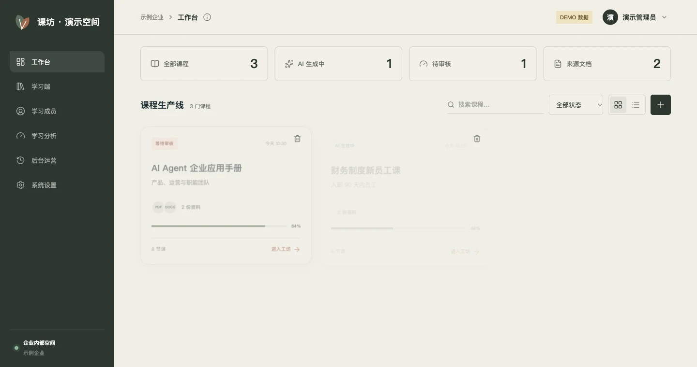
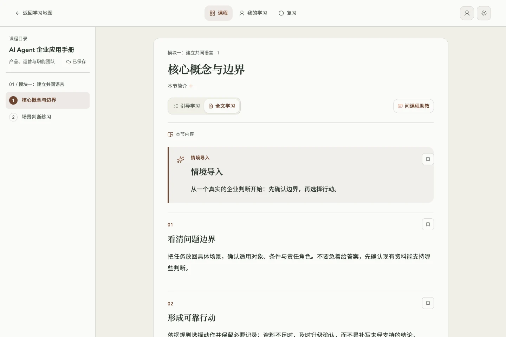
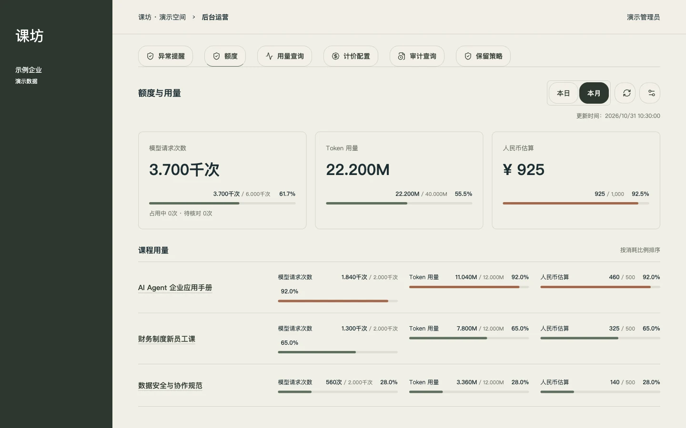
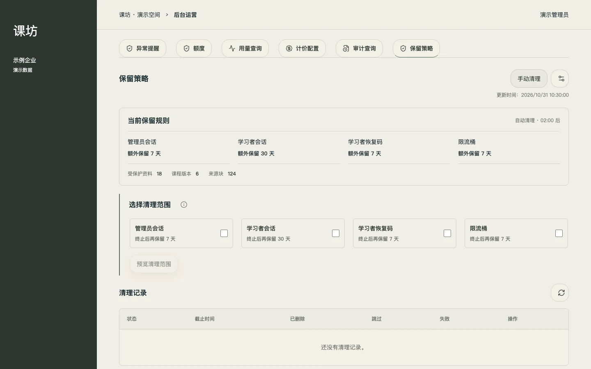

# 课坊 · 企业自定义课程平台

本课程来自**课坊平台（custom-course-platform）**。欢迎企业用户或团队联系作者，沟通使用、定制与授权。

[产品介绍（GitHub Pages）](https://songhonglei.github.io/ai-agent-learning/coursePlatform/) · [体验公开课程](https://my-agent-learning.vercel.app/) · [联系作者](https://github.com/Songhonglei) · [提交授权咨询](https://github.com/Songhonglei/ai-agent-learning/issues/new?title=课坊平台：企业授权与定制咨询)

> **课坊平台尚未开源。** 本目录仅介绍平台功能与展示演示截图，不包含平台业务源码、部署配置、企业资料或账号数据。需要使用平台的企业或团队，请联系作者 Evan Song 获取授权。本仓库课程代码的 MIT License 不意味着课坊平台也已开源。

## 核心功能

- **企业资料转课程**：解析 PDF、扫描件、DOCX、Markdown，按来源块保留页码与标题路径；分层生成摘要、学习目标、大纲和课节，中断后从检查点继续。
- **人工审核与发布**：大纲编辑、内容质检、课节校样、来源核对、单块重写、修订与并发保护；审核后发布，已发布快照保持稳定。
- **企业学习体验**：课程目录、邀请码、情境与互动练习、测验、进度、收藏、错题复习和学习档案；支持离线操作恢复同步。
- **有依据的课程助教**：围绕有权访问的课程问答，只使用已发布、已审核的来源引用；资料不足时明确说明。
- **运营治理**：异常提醒、操作审计、企业／课程配额、用量与价格记录、过期凭据保留策略。请求次数可硬限制，Token与费用用于提醒，未知成本不按零费用处理。

## 企业定制能力

| 方向 | 可配置或定制的内容 |
| --- | --- |
| 品牌空间 | 平台名称、Logo、配色、主题和助教名称／形象／欢迎语 |
| 课程内容 | 按企业资料、岗位对象、学习目标和案例调整课程与练习 |
| 登录与准入 | 标准 OIDC 企业登录、邮箱准入、邀请码和学习成员管理 |
| 模型服务 | 受支持协议的默认／备用文本模型与 OCR 专用视觉模型 |
| 运营规则 | 企业／课程额度、预算提醒、审计与过期凭据保留范围 |
| 进一步接入 | 按需求评估部署环境、内部系统对接和新增流程，再确认交付范围 |

已有能力与进一步定制的范围在沟通后确定，不将方案评估等同于现成功能。

 

全部截图为真实平台组件配合**虚构演示数据**，不含企业业务数据，也不代表生产用量。

## 授权说明

开源课程站与企业课程平台是独立维护的项目。这里公开的是介绍页面和演示截图，课坊平台（custom-course-platform）本身未开源。

有需要的企业或团队可通过[作者主页](https://github.com/Songhonglei)或[GitHub 使用咨询](https://github.com/Songhonglei/ai-agent-learning/issues/new?title=课坊平台：企业授权与定制咨询)联系 Evan Song，说明学习场景和定制需求，申请使用授权。
