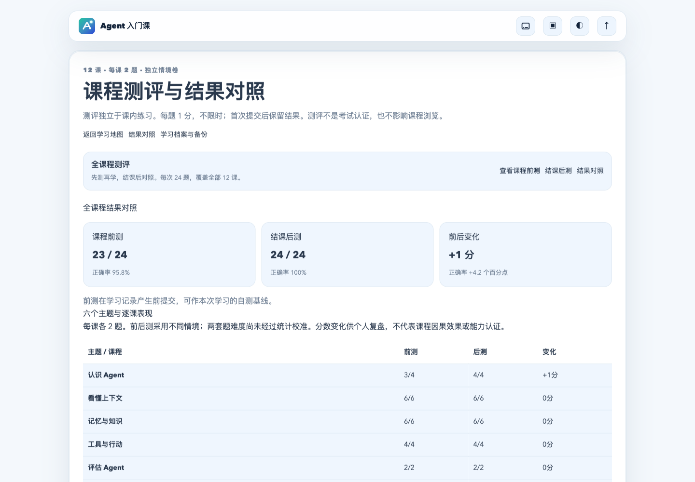
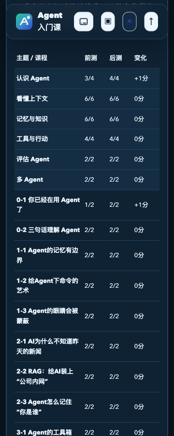

# 全课程测评验证报告

日期：2026-10-21。范围：独立开源项目，本地React/Vite/Node；未部署正式站，未使用真实Supabase账号或调用模型。

## 自动化实测

- npm run verify：43文件/203项单元测试、35项服务端测试、TypeScript/Vite构建、25项E2E全部通过。
- 其中11项测评E2E覆盖：1440px/360px各完整48题、提交二次确认与锁定、刷新续答、跳题与漏答拦截、11课后测门槛、v1兼容与1-1成绩隔离、跨标签答案同步、备份取消/确认、无前测后测、360/390/768/1024/1440px、键盘焦点、存储失败重试、最后一课结课直达。
- 原有14项E2E继续通过，包括12课互动关键路径、四档响应式、旧单课前后测、错题收藏、迁移恢复和主题同步。
- 单元覆盖48题每课/每卷覆盖、来源归属、题干不同、0/满分/负变化、学习中前测补测标识、先后顺序、非法记录拒绝、v1迁移、草稿/结果合并以及延迟云端响应防倒退。
- 35项服务端检查包括AI原保护回归、档案API v2往返与v1写入409。无SQL迁移。
- APP_PREVIEW_URL=http://127.0.0.1:4182 npm run verify:preview：dist生产预览冒烟通过。

## 浏览器实操

使用Ego浏览器同一个任务空间，开发预览4181与独立生产预览4182；不清空用户已有浏览器存储。

- 已实际逐题作答前测24题，首题故意答错，23/24（95.8%）；提交前无正确答案或解析，返回检查、确认提交、刷新后仍锁定，无可编辑radio。
- 前测完成前尝试后测深链，显示12课门槛；随后通过页面逐课“下一步/完成本课”核对结课入口。
- 已通过页面实际逐课产生12课完成记录，最后一课显示“开始结课后测”并可直达；再实际逐题完成后测24题，24/24（100%），结果对照显示+1分、+4.2个百分点，18行（6主题+12课）正确。
- 从4181页面点击导出JSON，在4182生产构建的独立空存储中选择同一文件。取消导入后storage仍为空；重新选择并确认后，v2、12课记录及23/24→24/24对照完整恢复。
- 实际查看1440px浅色结果页与360px深色对照表。手机viewport=360、scrollWidth=360、表宽300，内容无裁切；截图已逐张查看。
- 浏览器驱动出现过滚动点击及执行上下文瞬态超时；未将失败步骤当作通过。读取当前页后继续，并用键盘确认操作，草稿与结果未丢失。

## 解释边界

模拟作答验证软件行为，不是目标学员真实试学，不证明课程约3小时耗时或学习效果。平行卷未完成难度校准。真实云端RLS、邮箱登录和生产模型恢复不属于本轮已验证结果；Kimi fallback尚未实施。

## 截图证据

